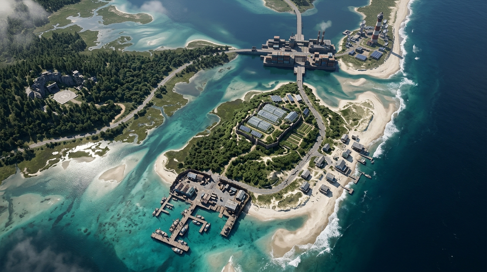
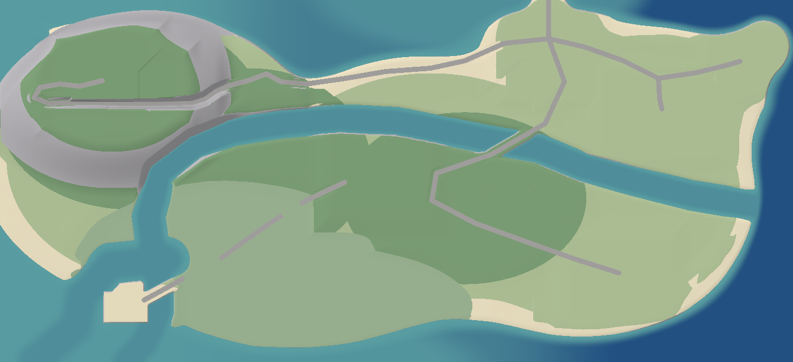
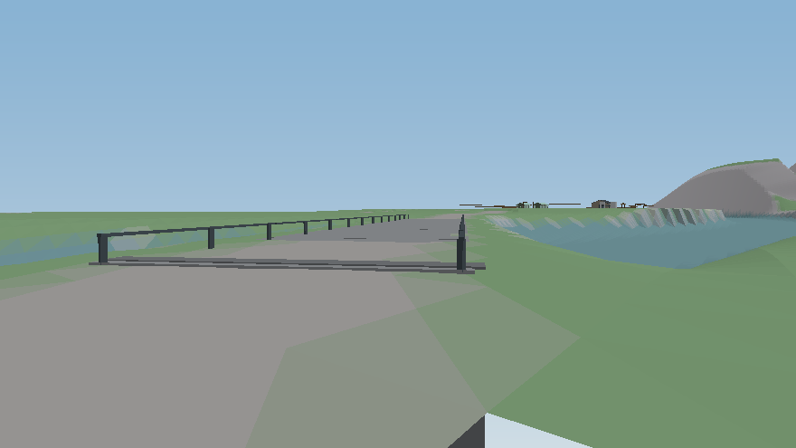
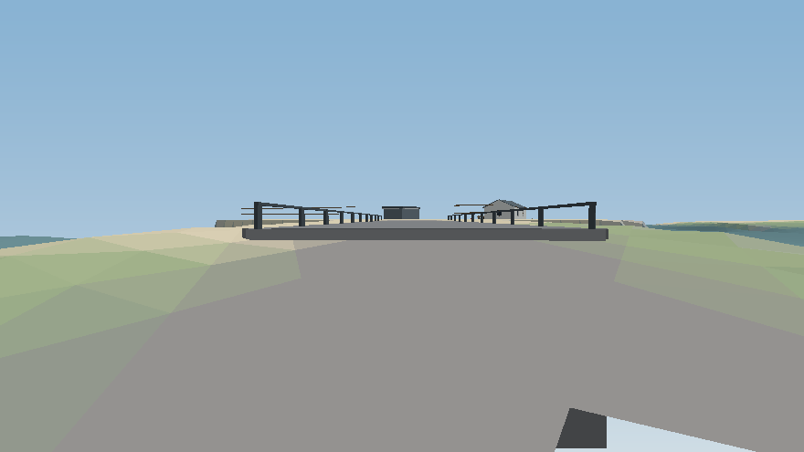
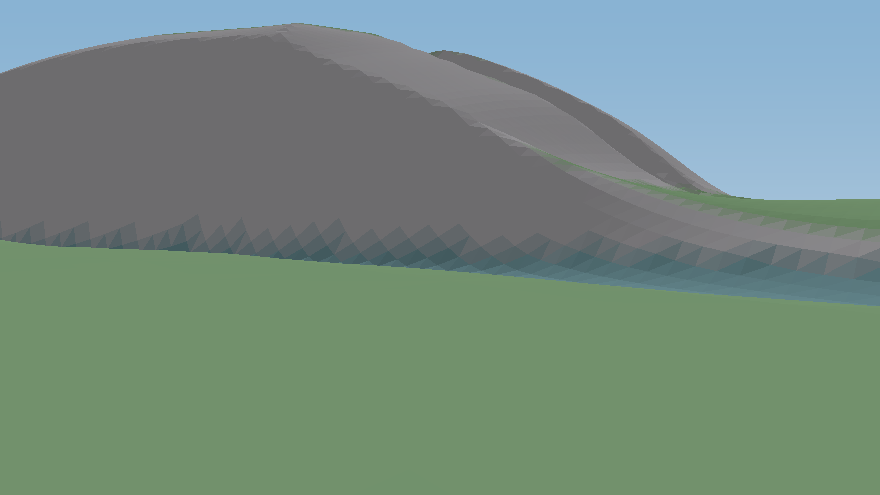

# Waist-Channel Terrain Revision — lane report (2026-10-22)

**Brief:** reconcile the deployed island with Ian's canonical aerial v2 — open water
through the waist, two founded road crossings — per-piece commits, lane gate green,
no push/deploy (Ty gates and ships).

**Gate:** tsc clean · full vitest **1051/1051** · production build OK.
**What moved: NOTHING.** No POI, pad, or stronghold was relocated. The only tight
clearance found (Jonah's camp, 32.9 m from the first candidate line, inside the
33 m nominal reach) was closed by moving the *line* (one vertex nudged west), never
the POI. A full numeric audit of every positioned dataset (sector pads + corners,
extra pads, POIs, reserved sites, structure sets, scatter, fleet homes) against the
final line is pinned as a test (`betaLayout.test.ts`, waist describe).

## Side by side: new overhead vs aerial v2 (canon)

| Aerial v2 (Ian's reference) | New island overhead (this lane) |
|---|---|
|  |  |

The channel runs Atlantic mouth → E–W waist reach → south bend → south sound exit,
separating Ridge/Citadel/Lighthouse (north) from Refuge/Pier/Tern Rock (south).
NC-12 crosses on the citadel deck; the west fork crosses the south bend on the pier
deck; the spur now runs the north coast and the plateau into the Ridge.

## What was done (4 commits + gate fix)

1. **Data** (`betaLayout.ts`): `BETA_WAIST_CHANNEL` (20-point centerline),
   `BETA_WAIST_HALFWIDTH` 15, `BETA_WAIST_CROSSINGS` pinned as data (below);
   `inland_spur` re-routed (see Routing). Stale Phase 1.5 comments rewritten to
   point at the new law.
2. **Terrain** (`betaTerrain.ts`): the carve lives in `landformAt` at the shared
   dredge depth (`BETA_CHANNEL_DEPTH` −4.2, spec §3.3 — Salt Skiff / Heavy
   Logistics Carrier navigable) with a tighter +18 m bank feather, so banks read
   as marsh shelves, not a bathtub cut. `stampBetaDecks` joins the build order
   (landform → pads → **decks** → roads → pads): a raise-only founded bed at each
   crossing so road profiles clamp onto the deck instead of diving to −4.2
   (an 8% grade cannot fall 1.5 → −4.2 → 1.5 inside the wet arc). Identity
   re-proven: Rapier probes extended over channel midpoints + both decks, worst
   sampler/physics divergence < 0.02 m (the test's bound), physics array still
   the grid verbatim.
3. **Deck geometry** (`Sectors.ts`): `buildCrossingDecks` — ground works, not
   kit buildings (the 24-kit census is untouched): slab panels at deck height,
   guardrail posts + top rails, abutment headwalls founded at the channel bed,
   one `causeway_deck` feature per crossing. No colliders (driven on the graded
   roadbed; rails are dressing — the gantry barrier-arm precedent). Refuge W-gate
   text fixed (it no longer claims the spur terminates there).
4. **Docs** (`worldWiring.ts`): W10 records the ROAD_GRAPH audit — see below.

## The crossings (pinned as data — `BETA_WAIST_CROSSINGS`)

| id | road | deck bed | span |
|---|---|---|---|
| `citadel_causeway` | `nc12_corridor` | 1.8 m | [231,−84] → [170,−49] |
| `pier_crossing` | `nc12_west_fork` | 2.0 m | [−396,183] → [−443,208] |

The pier deck is road, distinct from the Pier HQ boardwalk kit (which fronts the
*sound* channel off the pad's west edge, untouched). Pier deck height sits just
under the pad's surveyed 2.2 m so the road ramps onto the pad without an edge step.

**North land bridge:** the SDF causeway capsule north of the Citadel is *not*
removed. The aerial's northern water is the bay; the kit's gate towers and gantry
guard that causeway corridor (Act 2 mainland leg), and its crossing of the waist
channel is its south leg — the citadel deck above. Recorded in the layout comments.

## Routing

- **NC-12 / west fork:** polylines unchanged — they already crossed the v2 line at
  the two named points; the decks make those crossings founded.
- **Inland spur:** the old south-face traverse crossed the new channel, and Refuge
  →Ridge on roads now routes via NC-12 + Citadel anyway. The spur was re-routed:
  Citadel → north coast (around the north-bay inlet on its south shore) → relay
  knoll → east-face climb → forest-top/plateau traverse → into the Ridge pad from
  its west edge. The shape was dictated by the grade clamp's cone math, proven
  against the grid at every iteration: a clamped profile cannot climb a pad's
  feather ring at the edge — it must arrive across high ground with the arc to
  already be at height (the old south arrival's trick, mirrored). Final numbers:
  max longitudinal grade 0.144 ≤ 0.173 limit; crossfall ≤ 0.3 (both test-pinned
  for every road).
- **ROAD_GRAPH:** audited, deliberately **not** re-derived (W10 in
  `worldWiring.ts`): it has no runtime consumers (travel/faction data pinned by
  factions/stage7 tests), its nodes omit road-served POIs and its edges encode
  faction semantics the drawn-road data can't regenerate, and no edge becomes
  impossible — every north↔south journey now routes over one of the two decks
  (e.g. forest_cache→relay_station travels NC-12 over the citadel deck, then the
  spur). Re-derive it from BETA_ROADS + BETA_WAIST_CROSSINGS when a lane gives
  it a runtime consumer.

## Test replacements (deliberate, documented in the test bodies)

| Old pin (Phase 1.5 law) | Replacement |
|---|---|
| "the island waist is dry land" | Waist-line probes read navigable depth (−4.8 < h < −3.6 at 8 midpoints); every off-line probe from the old test keeps its ground; the shape-gate transect stays dry (carve reach 33 m doesn't reach it). |
| "no road runs into water" (absolute) | **New law:** every centerline sample still reads dry, AND any sample inside the carved reach (< 20 m from the line) must stand on a named crossing's span on its own road — any other wet roadbed fails. |
| — | Layout pins: line endpoints/bounds; exactly two crossings, spans lying ON their roads; carve clears every pad rect and land POI (the line moves, not the POI). |
| — | Deck pins: both deck centers read deck height (±0.5/0.6), quarter points > 0.9 m. |
| Strongholds "features stand on their pads" | `causeway_deck` exempted alongside `boat_slip` (water by design; beds pinned by the terrain tests). Decks added to EXPECTED_FEATURES per sector. |

## Collateral (all verified, suites green)

- **Vegetation:** placements derive from live zones — the new banks re-keyed
  automatically (marsh classes at the edges, nothing in open water); suite green
  unmodified.
- **Strongholds/POIs near the channel:** pad stamps re-assert interiors over the
  carve by design (the Pier pad's SE corner becomes a channel bank point, as
  drawn); strongholds + greeble + buildings suites green.
- **Drive test:** groundTruth 14/14 — the NC-12 physics drive still runs on the
  new route; settle sites unchanged.
- **Surf audio:** shoreline/surf derive from height/slope at runtime
  (`Game.ts` probes the grid), so the new shoreline is heard automatically;
  audio suite green (its pins are the gain curve, geography-independent).
- **Save compat:** terrain is procedural from the grid — no save format change;
  every surveyed height (spawn, pads, fleet homes) is pinned unchanged by the
  layout/terrain suites, and save + vehicle-persistence suites pass unmodified.

## Eye-level proof

Software-rasterized from the real grid + buildSectors geometry
(`tools/render_waist_eyelevel.ts`; a proof instrument, not the game renderer —
2.5 m tessellation sawtooths steep banks and a culled-triangle notch can appear
at frame corners).

| Citadel causeway (from NC-12, looking S) | Pier crossing (from the fork, looking WNW) | Channel from the south-bank marsh |
|---|---|---|
|  |  |  |

## Residuals

- **No daymarkers on the waist channel** this pass (the sound channel's set is
  untouched). A waist set generated from the line, like the sound set, is a
  small follow-up.
- **Deck kit scope:** slab + rails + abutments over a founded bed (the bed is
  the mid-span founding — a true causeway section). No mid-span pile bents;
  add if the visual gate wants a more bridge-like read at the citadel span.
- **Old saves:** a vehicle parked mid-waist *off* surveyed ground in an old
  save would now sit in the channel shallows (world changed under it; saves
  themselves load fine — heights are not save state).
- The overhead at `design-refs/proof-beta-terrain/beta_overhead.png` was
  regenerated by its canonical tool and now shows the revised island.
